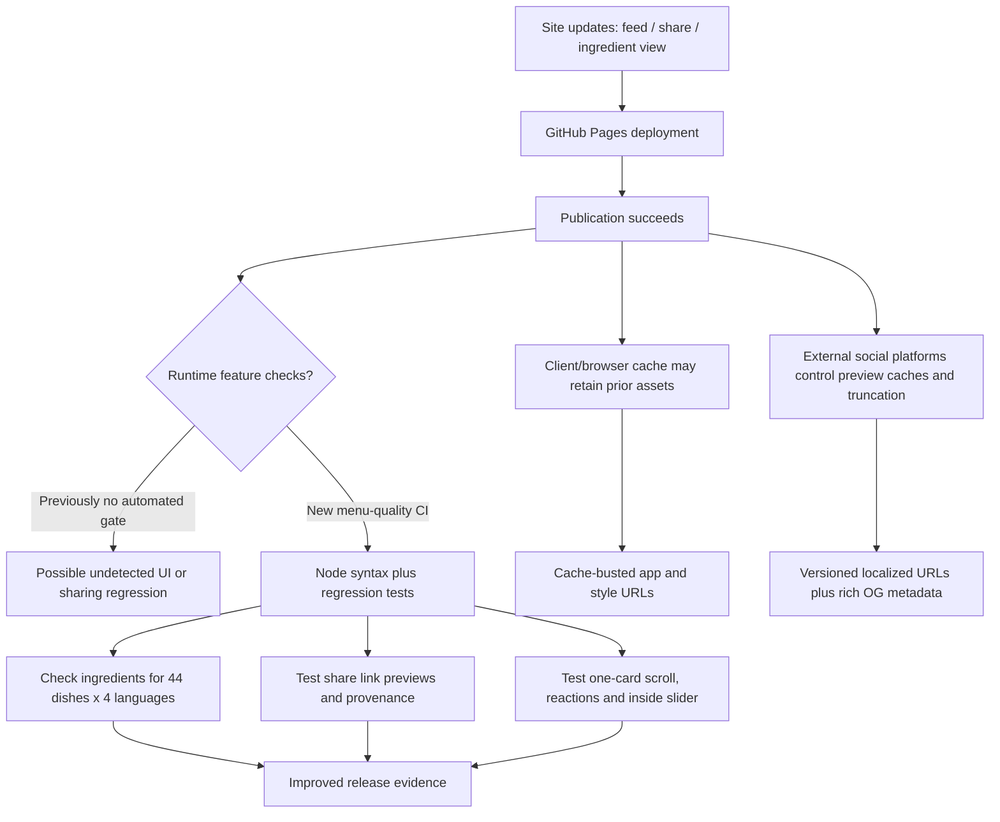

# Halk Büfe — fault dependency map and release gate (2026-11-10)

## Evidence
- Latest observed `pages build and deployment` run for main commit `66a72d339...`: success, [run 42830635416](https://github.com/safal207/halk-bufe-selinus/actions/runs/42830635416).
- Prior main commit had no `.github/workflows/` entries, so menu regression tests were not automatically required before site deployment.
- The public Russian dish share preview contained localized ingredients and provenance. A successful Pages run alone did **not** validate the social controls, interactive reveal, copied text, or wheel navigation.
- Browser/CDN caching and third-party social preview truncation are **potential** issues; they are not proven causes of a current failure.

## Causal dependency graph

## What changed
1. Added `.github/workflows/menu-quality.yml` running `npm run check` and `npm test` on PRs and main.
2. Added a deterministic Node test command in `package.json`, with coverage for menu, nutrition, social actions, scrolling, rich sharing, and the draggable ingredient reveal.
3. Added an accessible, localized ingredient comparison for all dishes. Ingredient provenance (`menu`, `typical`, `unknown`) remains visible and no real photographic cutaway is implied.
4. Bust `index.html` asset versions for the newly introduced JS/CSS functionality.

## Remaining release evidence
- CI must complete green on the *exact* PR/head SHA; never claim pass until it does.
- Manual mobile/browser tap, hover, scroll and social Web Share checks cannot be inferred from source-level tests.
- Preview text may still be truncated by WhatsApp/Telegram/Instagram independently of the website.
